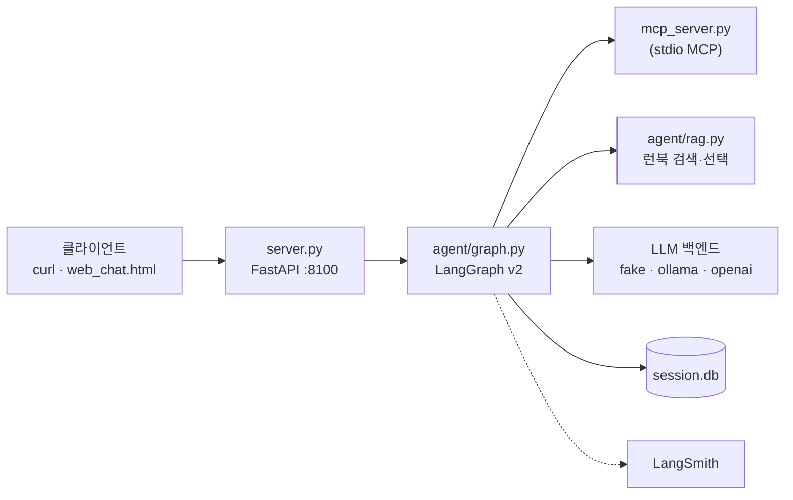

# Incident Response Agent

운영 장애 질문을 받아 모니터링 수치와 런북을 근거로 진단 답변을 생성하는 LangGraph 기반 에이전트 서비스입니다.
답변은 관측·런북과 대조 검증을 거친 뒤 반환되며, 요청 한 건의 전 과정이 LangSmith에 기록됩니다.

## 주요 기능

- **대상 시스템 확인** — 요청에서 진단 대상을 식별하고, 모호하면 조사 전에 사용자에게 확인합니다.
- **MCP 기반 근거 수집** — 별도 프로세스의 MCP 서버에서 모니터링(Tool)·런북(Resource)·진단 절차(Prompt)를 조회합니다.
- **런북 RAG** — 질문과 관측을 임베딩해 시스템별로 런북 후보를 찾고, 선택 모델이 근거 여부를 판정합니다.
- **답변 검증·재작성** — 초안을 관측·런북과 대조해 반려 시 피드백으로 재작성하고, 끝내 검증되지 않으면 확인된 관측만 안내합니다.
- **교체 가능한 모델 백엔드** — `fake`(결정론) / `ollama`(로컬) / `openai`(API)를 환경 변수로 전환합니다.
- **스트리밍·세션** — SSE로 노드별 진행 상황을 전송하고, SQLite에 대화 이력을 저장해 재시작 후에도 유지합니다.

## 아키텍처



진단 요청은 아래 순서로 처리됩니다.

```text
prepare_request → route ─┬─ chat_answer                      (일반 대화)
                         └─ resolve_targets → plan → gate → research
                              → replan_check(RAG) → [analysis] → write ⇄ validate → finalize
```

노드별 상세 설명과 유스케이스 시퀀스는 [doc/README.md](doc/README.md)에 있습니다.

## 시작하기

### 요구 사항

- Python 3.11 이상 (CI 기준 3.14)
- [Ollama](https://ollama.com) — `LLM_BACKEND=ollama` 또는 `RAG_BACKEND=ollama`(기본값)를 사용할 때
- OpenAI API 키 — `openai` 백엔드를 사용할 때 (**과금**)
- LangSmith API 키 — 추적을 기록할 때 (선택)

### 설치

```bash
bash sh/setup_venv.sh          # .venv 생성 및 requirements.txt 설치
cp .env.example .env           # API 키 등 설정값 입력
```

로컬 모델을 사용한다면 Ollama 모델을 준비합니다.

```bash
bash sh/setup_ollama.sh             # qwen3:0.6b / qwen3:8b
ollama pull embeddinggemma:300m     # RAG_BACKEND=ollama의 임베딩 모델
```

### 실행

| 목적 | 명령 | 비고 |
|---|---|---|
| 로컬 모델로 서버 기동 | `bash sh/run_agent_ollma.sh` | 비용 없음 |
| OpenAI로 서버 기동 | `bash sh/run_agent_openai.sh` | LLM·RAG 모두 OpenAI, **과금** (실행 전 확인) |
| 웹 채팅 화면 | `bash sh/run_frontend.sh` | 서버 기동 후 `http://localhost:8600` |

서버가 뜨면 다음과 같이 호출합니다.

```bash
curl -s -X POST localhost:8100/chat -H 'Content-Type: application/json' \
  -d '{"message":"payments-service CPU 급증 원인 진단해줘","thread_id":"t-1"}'
```

## 설정

`.env` 또는 실행 환경 변수로 지정합니다. 비워 두면 기본값을 사용합니다.

| 변수 | 기본값 | 설명 |
|---|---|---|
| `LLM_BACKEND` | `fake` | 답변 생성 백엔드: `fake` / `ollama` / `openai` |
| `RAG_BACKEND` | `ollama` | 런북 임베딩·선택 백엔드: `ollama` / `openai` |
| `SUPERVISOR_VERSION` | `v2` | `v1`이면 검증·RAG 없는 legacy 선형 파이프라인 |
| `OPENAI_API_KEY` | — | OpenAI 백엔드 사용 시 필수 |
| `OPENAI_FAST_MODEL` / `OPENAI_QUALITY_MODEL` | `gpt-4o-mini` / `gpt-4o` | 라우팅·계획 / Writer 모델 |
| `OPENAI_VALIDATOR_MODEL` | `gpt-4o` | 답변 검증 모델 (Writer와 별도 설정) |
| `OLLAMA_FAST_MODEL` / `OLLAMA_QUALITY_MODEL` | `qwen3:0.6b` / `qwen3:8b` | 로컬 백엔드 모델 |
| `OLLAMA_VALIDATOR_MODEL` | `qwen3:8b` | 로컬 답변 검증 모델 (Writer와 별도 설정) |
| `RAG_EMBEDDING_MODEL` / `RAG_SELECTION_MODEL` | `embeddinggemma:300m` / `qwen3:8b` | Ollama RAG 모델 |
| `RAG_OPENAI_EMBEDDING_MODEL` / `RAG_OPENAI_SELECTION_MODEL` | `text-embedding-3-small` / `gpt-4o-mini` | OpenAI RAG 모델 |
| `RAG_OLLAMA_URL` | `http://127.0.0.1:11434` | Ollama 주소 |
| `LANGCHAIN_TRACING_V2`, `LANGCHAIN_API_KEY` | — | LangSmith 추적 (실행 스크립트가 백엔드별 프로젝트를 지정) |

## API

| 메서드 | 경로 | 설명 |
|---|---|---|
| `GET` | `/health` | 상태와 적용된 백엔드·모델 정보 |
| `GET` | `/version` | 실행 중인 supervisor 버전 |
| `POST` | `/chat` | 답변과 메타데이터(`langsmith_run_id` 포함) 반환 |
| `GET` | `/chat/stream` | SSE로 노드 이벤트를 전송하고 최종 답변 후 `[DONE]` |

## 테스트

외부 모델 호출과 추적 전송 없이 실행됩니다. CI(GitHub Actions)도 같은 명령을 사용합니다.

```bash
.venv/bin/python -m pip install -r requirements-dev.txt
sh sh/lint.sh     # Ruff 정적 검사
sh sh/test.sh     # pytest 회귀·평가 테스트
```

커밋 전에 Ruff 검사가 자동으로 돌도록 clone 후 한 번 훅 경로를 지정합니다.

```bash
git config core.hooksPath .githooks
```

실제 모델을 호출하는 회귀 평가와 LangSmith 비교 실험은 [evaluation/README.md](evaluation/README.md)를 참고하세요.

## 프로젝트 구조

```text
.
├── server.py                 # FastAPI 진입점
├── mcp_server.py             # MCP 서버 "ops" — 모니터링·런북·진단 프롬프트
├── mcp_server_docs.py        # MCP 서버 "docs" — 멀티 서버 탐색 확인용 decoy
├── web_chat.html             # Vue 3 채팅 화면 (빌드 단계 없음)
├── web_demo_server.py        # 채팅 화면 서빙 + API 프록시 (:8600)
├── agent/
│   ├── graph.py              # v2 LangGraph 노드·엣지
│   ├── runtime.py            # 모델·MCP·저장소·RAG 조립과 정리
│   ├── targets.py            # 대상 시스템 확인
│   ├── evidence.py           # 조사 자료 수집
│   ├── rag.py                # 런북 RAG (임베딩 검색 + 근거 선택)
│   ├── writer.py             # 답변 초안 생성
│   ├── validation.py         # 답변 내용 검증
│   ├── mcp_client.py         # 다중 MCP 세션 클라이언트
│   ├── *_llm.py              # fake / ollama / openai 백엔드
│   └── session_store.py      # SQLite 세션 저장소
├── data/                     # 모니터링 데이터, 런북 6종
├── tests/                    # 오프라인 자동화 테스트
├── evaluation/               # 회귀 평가·LangSmith 비교 도구
├── eval/, baseline/          # Before 측정 데이터셋과 baseline 보존본
├── doc/                      # 설계·운영 문서
└── sh/                       # 설치·실행·테스트 스크립트
```

## 문서

| 문서 | 내용 |
|---|---|
| [doc/README.md](doc/README.md) | 상세 아키텍처와 유스케이스 시퀀스 |
| [doc/target-system-confirmation.md](doc/target-system-confirmation.md) | 대상 시스템 확인 규칙 |
| [doc/evidence-collection.md](doc/evidence-collection.md) | 조사 자료 수집 모듈 구조 |
| [doc/runbook-rag.md](doc/runbook-rag.md) | 런북 RAG 검색·선택 방식 |
| [doc/answer-validation.md](doc/answer-validation.md) | 답변 검증 범위와 비용 |
| [doc/mcp-call-safety.md](doc/mcp-call-safety.md) | MCP 입력·응답 검증과 시간 제한 |
| [doc/manual_ollma.md](doc/manual_ollma.md), [doc/manual_openai.md](doc/manual_openai.md) | 화면 캡처가 포함된 사용 가이드 |
| [evaluation/README.md](evaluation/README.md) | 평가 실행과 LangSmith 실험 |
| [baseline/README.md](baseline/README.md) | 성능 비교용 baseline |
