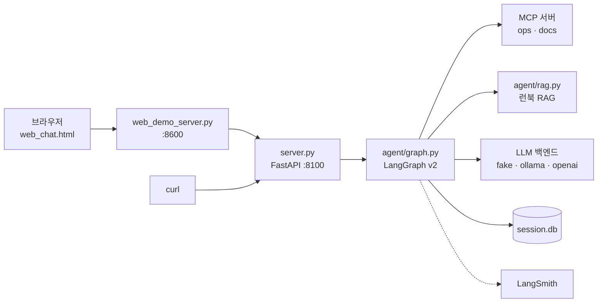
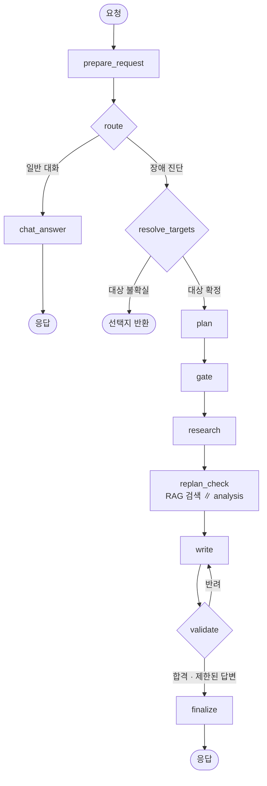
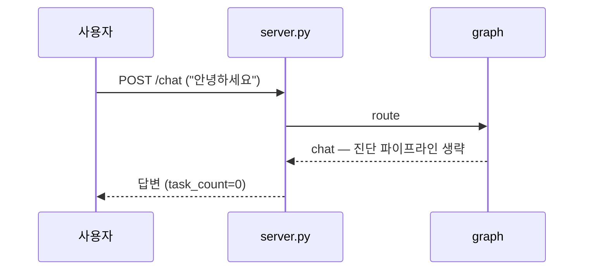
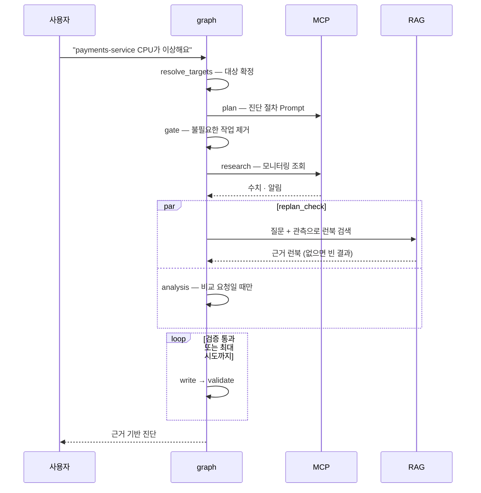
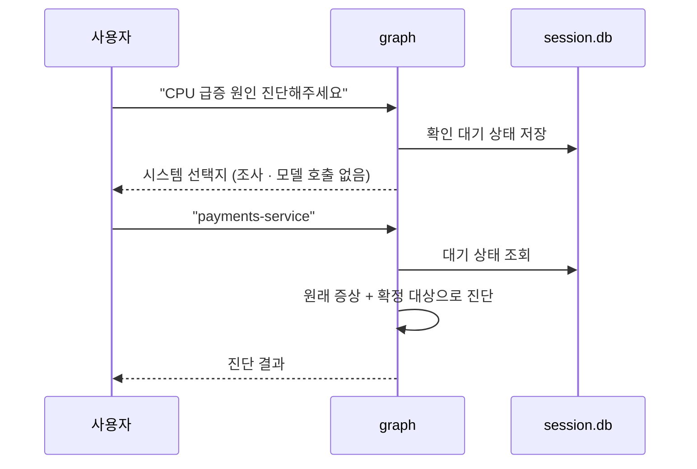
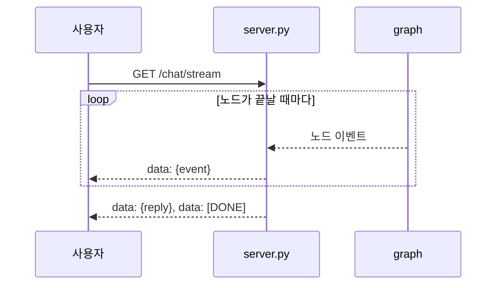
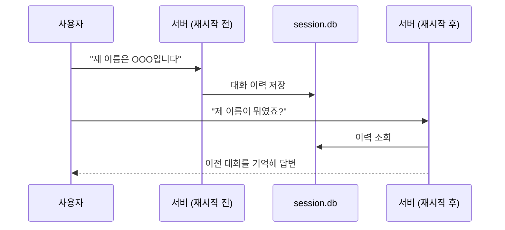
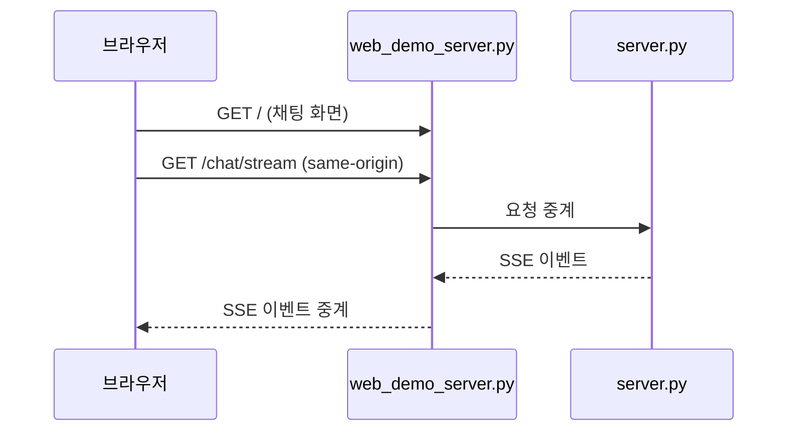

# 아키텍처 가이드

운영 장애 질문을 받아 모니터링 수치와 런북을 근거로 진단 답변을 만드는 에이전트의 **내부 구조와 처리 흐름**을 설명합니다.
설치·실행·환경 변수는 [프로젝트 README](../README.md)를 먼저 보세요.

> 백엔드는 원본 `all_total`과 같고, 채팅 화면(`web_chat.html`)만 Vue 3(CDN, 빌드 단계 없음)로 다시 작성했습니다.

**목차**

1. [구성 요소](#1-구성-요소)
2. [요청 처리 흐름](#2-요청-처리-흐름)
3. [핵심 설계](#3-핵심-설계)
4. [유스케이스별 시퀀스](#4-유스케이스별-시퀀스)
5. [디렉터리 구조](#5-디렉터리-구조)
6. [관련 문서](#6-관련-문서)

---

## 1. 구성 요소



| 구성 요소 | 역할 |
|---|---|
| `server.py` | `/health` · `/version` · `/chat` · `/chat/stream`(SSE) 제공. 시작 시 실행 환경을 한 번 조립 |
| `agent/graph.py` | 요청 한 건을 처리하는 LangGraph 상태 그래프 |
| `mcp_server.py` (ops) | 모니터링 조회(Tool), 런북 원문(Resource), 진단 절차(Prompt) 제공 |
| `mcp_server_docs.py` (docs) | API 문서만 제공하는 decoy. 멀티 서버 탐색 확인용이며 에이전트는 사용하지 않음 |
| `agent/rag.py` | 질문·관측으로 런북을 검색하고 근거 여부를 판정 |
| `session.db` | 대화 이력과 대상 확인 대기 상태 저장 (SQLite) |
| LangSmith | 노드별 계층 trace, 평가, 피드백 기록 |

---

## 2. 요청 처리 흐름



| 노드 | 하는 일 |
|---|---|
| `prepare_request` | 대상 확인을 기다리던 대화면 사용자의 선택·취소·새 질문을 구분 |
| `route` | 일반 대화와 장애 진단을 분류 |
| `chat_answer` | 진단 파이프라인 없이 바로 답변 |
| `resolve_targets` | 진단 대상 시스템을 확정. 불확실하면 조사하지 않고 선택지를 반환 |
| `plan` | MCP Prompt로 진단 절차를 받아 할 일 목록 작성 |
| `gate` | 불필요한 작업 제거 |
| `research` | 대상 시스템의 모니터링 수치·알림 수집 |
| `replan_check` | 런북 RAG 검색과 비교 분석(`analysis`)을 동시에 실행 |
| `write` | 수집한 근거로 답변 초안 작성 |
| `validate` | 초안을 관측·런북과 대조. 반려하면 피드백과 함께 `write`로 되돌림 |
| `finalize` | 최종 답변 확정, 대상 확인 대기 상태 정리 |

`SUPERVISOR_VERSION=v1`이면 이 그래프 대신 라우팅·검증·RAG가 없는 legacy 선형 파이프라인(`agent/supervisor_v1.py`)을 사용합니다.

---

## 3. 핵심 설계

| 설계 | 내용 |
|---|---|
| **실행 환경 1회 조립** | `server.py`의 lifespan이 `agent/runtime.py`로 LLM·MCP 연결·세션·RAG 색인·Validator를 한 번만 만들고, 종료 시 정리합니다. |
| **환경 변수로 교체** | `LLM_BACKEND`, `RAG_BACKEND`, `SUPERVISOR_VERSION`만 바꾸면 되고 그래프 코드는 바뀌지 않습니다. |
| **대상 확인 후 조사** | 대상이 불확실하면 MCP·RAG·작성 모델을 호출하지 않습니다. 사용자가 고르면 원래 증상으로 진단을 재개합니다. |
| **MCP 서버 탐색** | 어느 서버가 필요한 prompt·resource를 가졌는지 하드코딩하지 않고 `find_prompt()` · `find_resource_template()`로 먼저 찾습니다. |
| **근거 없으면 고르지 않음** | RAG는 시스템별 상위 3개 후보를 찾고, 선택 모델이 시스템마다 근거를 판정합니다. 근거가 없으면 런북을 임의로 붙이지 않습니다. |
| **필요할 때만 분석** | `analysis`는 명시적 비교 요청과 서로 다른 두 시스템의 관측이 모두 있을 때만 모델을 호출합니다. |
| **강제 합격 없음** | 검증을 끝내 통과하지 못하면 확인된 관측만 담은 제한된 답변을 반환합니다. |

---

## 4. 유스케이스별 시퀀스

### 4.1 일반 대화



### 4.2 장애 진단



### 4.3 대상 시스템 확인



### 4.4 실시간 스트리밍



### 4.5 서버 재시작 후 대화 기억



### 4.6 웹 채팅 화면



---

## 5. 디렉터리 구조

```text
.
├── server.py              FastAPI 진입점
├── mcp_server.py          MCP 서버 "ops"
├── mcp_server_docs.py     MCP 서버 "docs" (decoy)
├── web_chat.html          채팅 화면
├── web_demo_server.py     채팅 화면 서빙 + API 프록시
├── agent/                 에이전트 본체 (아래 표)
├── data/                  monitoring.json, runbooks/ 6종
├── tests/                 오프라인 자동화 테스트
├── evaluation/            회귀 평가 · LangSmith 비교 도구
├── eval/                  Before 측정 · RAG 평가 데이터셋
├── baseline/              성능 비교용 baseline 보존본
├── doc/                   문서
└── sh/                    설치 · 실행 · 린트 · 테스트 스크립트
```

**`agent/` 모듈**

| 분류 | 파일 | 역할 |
|---|---|---|
| 조립 | `runtime.py` | 실행 환경 조립과 자원 정리 |
| | `deps.py` | `SupervisorDeps` 의존성 주입 |
| | `model_factory.py` | 환경 변수에 따른 fast · Writer · Validator 모델 생성 |
| 그래프 | `graph.py` | v2 LangGraph 노드와 엣지 |
| | `supervisor_v1.py` | legacy 선형 파이프라인 |
| 단계별 로직 | `targets.py` | 대상 시스템 판별, 확인 응답 분류 |
| | `evidence.py` | 조사 자료 수집 Interface와 MCP 구현 |
| | `rag.py` | 런북 임베딩 검색과 시스템별 근거 선택 |
| | `analysis_policy.py` | 명시적 비교 요청 판별 |
| | `writer.py` | 답변 초안 프롬프트 · 근거 · 피드백 구성 |
| | `validation.py` | 초안과 관측 · 런북 대조 |
| 모델 백엔드 | `fake_llm.py` · `ollama_llm.py` · `openai_llm.py` | `LLM_BACKEND`별 구현 |
| 인프라 | `mcp_client.py` | 다중 MCP 세션과 서버 탐색 |
| | `mcp_errors.py` | 재시도 대상이 아닌 MCP 오류 |
| | `retry.py` | 일시적 오류용 backoff 재시도 |
| | `session_store.py` | SQLite 세션 저장소 |

---

## 6. 관련 문서

| 주제 | 문서 |
|---|---|
| 대상 시스템 확인 규칙 | [target-system-confirmation.md](target-system-confirmation.md) |
| 조사 자료 수집 구조 | [evidence-collection.md](evidence-collection.md) |
| 런북 RAG 검색 · 선택 | [runbook-rag.md](runbook-rag.md) |
| 답변 내용 검증 | [answer-validation.md](answer-validation.md) |
| MCP 호출 안전성 | [mcp-call-safety.md](mcp-call-safety.md) |
| 화면 캡처 포함 사용 가이드 | [manual_ollma.md](manual_ollma.md) (로컬) · [manual_openai.md](manual_openai.md) (OpenAI) |
| 수동 회귀 테스트 질문 목록 | [regression_test_queries.md](regression_test_queries.md) |
| 회귀 평가 · LangSmith 비교 | [evaluation/README.md](../evaluation/README.md) |
| Before 재측정 절차 | [eval/REPOSITORY_USAGE.md](../eval/REPOSITORY_USAGE.md) |
| 성능 비교용 baseline | [baseline/README.md](../baseline/README.md) |

> 사용 가이드의 강제 재시도 · 병렬 지연 시연은 baseline 이전 원본 동작을 설명하는 자료입니다.
